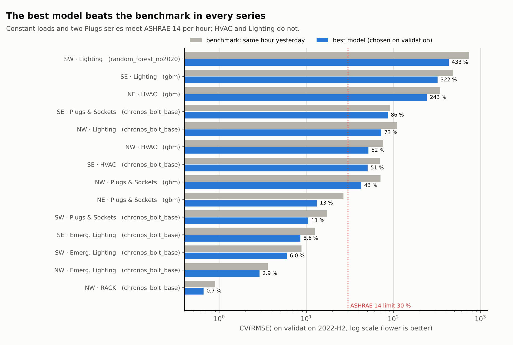
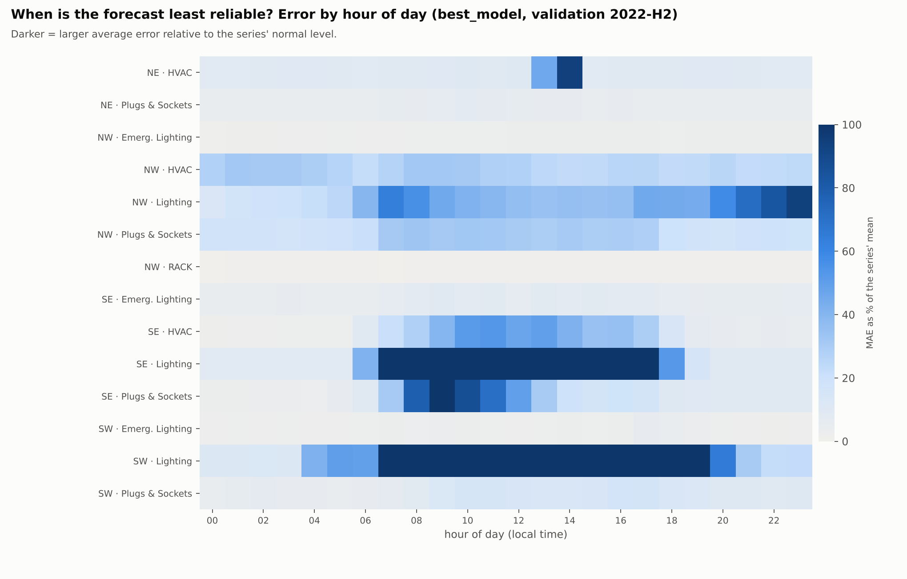

# Team B – Sprint 3 results (T28, T34, T35)

**Author:** Marie Heyse (Team B – Data Quality & Validation) · **Date:** 14 November 2026
**Input:** all subteam D forecasts on GitHub (Chronos, CatBoost, Random Forest with and without 2020, GBM, LightGBM, seasonal naive) plus the reference benchmarks (naive_day, naive_week): 10 models, 763,171 forecast hours.

| Script | What it does |
| --- | --- |
| `T36_combine_predictions.py` | Merges every predictions file (also inside the zips) into one file, sets the same split names for all models and checks the timestamps against the clean dataset |
| `TeamB_select_best_model.py` | Chooses the best model per series **on the validation period only** (same hours for every model), then reports its test scores |
| `team_b_eval.py` | ASHRAE 14 table, error breakdown, anomaly candidates and sensitivity to quality flags |

## 0. Data check before the evaluation (important for subteam D)

- All files are in the agreed format and `y_true` matches the clean dataset (v0.4) in 100 % of rows, **except GBM**.
- `All_Zones_GBM_predictions.csv` stores **local (Madrid) time** in the column `timestamp_utc`: 95 % of rows do not match as UTC, 0 % mismatch as local time. The scores of GBM itself are correct, but it was shifted 1–2 hours against the other models and against the calendar. `T36_combine_predictions.py` now converts it to UTC automatically.
- GBM also labels the whole out-of-sample period `test`; the combine script re-labels it by date (validation / test_2023 / test_2025).
- After the fix, every check passes (5–10 rows around the October clock change remain, negligible).

## 1. Best model per series (selection on validation, scores on test)



| Series | Best model | Validation CV(RMSE) | Benchmark | test 2023 | test 2025 |
| --- | --- | --- | --- | --- | --- |
| NE HVAC | gbm | 243 % | 345 % | 689 % | **15 %** ✓ |
| NE Plugs & Sockets | gbm | **13 %** ✓ | 27 % | **19 %** ✓ | **8 %** ✓ |
| NW HVAC | gbm | 52 % | 76 % | **30 %** ✓ | 86 % |
| NW Lighting | chronos | 73 % | 110 % | 62 % | 91 % |
| NW Plugs & Sockets | gbm | 43 % | 71 % | 40 % | 52 % |
| SE HVAC | chronos | 51 % | 69 % | 40 % | 35 % |
| SE Lighting | gbm | 322 % | 481 % | 204 % | 284 % |
| SE Plugs & Sockets | chronos | 86 % | 92 % | 123 % | **29 %** ✓ |
| SW Lighting | random_forest_no2020 | 433 % | 734 % | 209 % | – |
| SW Plugs & Sockets | chronos | **11 %** ✓ | 17 % | **18 %** ✓ | – |
| NW RACK | chronos | **0.7 %** ✓ | 0.9 % | **0.5 %** ✓ | **3.6 %** ✓ |
| NW Emerg. Lighting | chronos | **2.9 %** ✓ | 3.6 % | **5.3 %** ✓ | 34 % |
| SE Emerg. Lighting | chronos | **8.6 %** ✓ | 12.4 % | **12.4 %** ✓ | **14 %** ✓ |
| SW Emerg. Lighting | chronos | **6.0 %** ✓ | 8.8 % | **10.5 %** ✓ | – |

✓ = meets ASHRAE 14 (CV(RMSE) ≤ 30 % and |NMBE| ≤ 10 %). Benchmark = same hour yesterday on the same hours. Full numbers with NMBE: `best_model_selection.csv`.

**Findings**
- The best model **beats the benchmark in 14 of 14 series** on validation and on test 2023, and in 9 of 11 on test 2025 (exceptions: NE and NW Plugs & Sockets, where the 2025 level is very stable and "same hour yesterday" is hard to beat).
- ASHRAE 14 per hour is met by **6 of 14 series** on validation (all constant loads plus NE and SW Plugs & Sockets), 7 of 14 on test 2023 and 5 of 11 on test 2025.
- Chronos is best for 8 series, GBM for 5, Random Forest (without 2020) for 1. No single model wins everywhere, so the dashboard and report use the best model per series.
- The variant without 2020 was only chosen for SW Lighting; for the other series the full training set (with 2020) scored better.

## 2. T34 (F6.6) – when is the forecast least reliable?



Error = MAE as % of the mean, priority series (HVAC, Lighting, Plugs & Sockets), best model, validation:

| By | Result |
| --- | --- |
| Hour of day | Lowest at night (17–22 % from 00 to 06 h), highest at the **start and end of the working day**: 29–30 % at 07–09 h and **34 % at 17 h**. The model knows the daily pattern but not the exact moment devices switch on and off |
| Day type | Weekend 20 % · working day 26 % · **holiday 29 %** (few holidays to learn from) |
| Season | Validation: summer 17 %, winter 24 %, autumn 30 %. Tests: winter 2023 31 %, summer/autumn 2025 34–35 % |
| Zone / load | Lighting is the hardest (SE 82 %, SW 110 % of the mean, with a strong under-forecast bias of 41–60 %); HVAC 14–27 %; Plugs & Sockets 5–24 %; constant loads 0–6 % |

Sheets *Errors_by_hour*, *Errors_by_season*, *Errors_by_daytype*, *Errors_by_zone* in `TeamB_evaluation_best_model.xlsx`.

## 3. T35 (F7.1) – candidate anomalies

Days and hours where the best model is far off compared with its normal error (robust z-score), at most 3 per series, each with a first explanation from the calendar and the quality flags. Main candidates:

| Date | Series | Actual vs forecast | First explanation |
| --- | --- | --- | --- |
| 3, 17 and 20 Feb 2023 | NE HVAC | 1.1–3.5 kWh vs ~0.07 kWh | Quality flags in 33–42 % of hours: counter spikes, likely a meter problem rather than real use |
| 22 and 29 Aug, 28 Sep 2025 | SE Lighting | 11.7–14.3 kWh vs 0.3–1.3 kWh | Lighting on during August low use and on a Sunday; 2025 level shift of this series: check whether lights were left on |
| 19–20 Dec 2022 | SW Lighting | 8.4–9.9 kWh vs 0.7–1.1 kWh | Quality flags in 50 % of hours |
| 1 Dec 2022, 30 Jan 2023 | SE Plugs & Sockets | 3.0–6.3 kWh vs 0.7–1.6 kWh | **No context found**: check on site (behaviour change or meter fault) |
| 26–27 Jul 2022 | SE HVAC | about twice the forecast | Quality flags in ~30 % of hours |

Full list: sheets *Anomaly_days* (17 days) and *Anomaly_hours* in `TeamB_evaluation_best_model.xlsx`.

## 4. T28 (F2.2) – secondary loads: closed

| Load | Result | Conclusion |
| --- | --- | --- |
| RACK (NW) | Chronos CV(RMSE) 0.7 % (validation), 0.5 % (2023), 3.6 % (2025) | Predictable; passes ASHRAE in every period |
| Emergency lighting (NW, SE, SW) | Chronos 2.9–8.6 % (validation), 5.3–12.4 % (2023) | Predictable. NW 2025 (34 %) fails only because of flagged hours: 4.3 % without them |
| RACK (SW) | Series ends in Dec 2021 | No validation or test period, so not forecast |
| Hand dryers (NW, SW) | Event-driven (F2.2 characterisation) | Not forecastable per hour; reported as daily totals and as anomaly source |

The constant loads are easy to forecast, but even the simple benchmark is already within ASHRAE (0.9–12 %), so models add little value here. This confirms the priority of section 3 of the backlog: the forecasting effort belongs to HVAC, Lighting and Plugs & Sockets.

## 5. Also ready for Sprint 4 (T38, T40)

- **T38 (F6.4):** ASHRAE 14 table for all 10 models and every series and period: sheet *ASHRAE_table* in `TeamB_evaluation_all_models.xlsx`.
- **T40 (F6.7):** sheet *Sensitivity_flags*. Removing flagged hours changes some scores a lot: NE HVAC validation 243 % → **12 %**, SE Plugs & Sockets 119 % → 60 %, SE HVAC 51 % → 28 %. For these series the large errors come from meter problems, not from the model. For SE and SW Lighting the score gets worse without flagged hours, so their problem is the series itself (rare, large switch-on events).

## Files

| File | Content |
| --- | --- |
| `TeamB_Sprint3_results.md` | This summary |
| `best_model_selection.csv` | Best model per series with validation and test scores |
| `TeamB_evaluation_best_model.xlsx` | T34, T35, T40 for the best model per series (+ benchmark) |
| `TeamB_evaluation_all_models.xlsx` | T38: ASHRAE table and checks for all 10 models |
| `F13_best_model_vs_benchmark.png`, `F11_error_by_hour_best_model.png` | Figures for the report and the presentation |
| `T36_combine_predictions.py`, `TeamB_select_best_model.py`, `team_b_eval.py` | Code to reproduce |

**Reproduce:**
```bash
python T36_combine_predictions.py model_outputs all_model_predictions.csv cleaned
python TeamB_select_best_model.py all_model_predictions.csv
python team_b_eval.py best_model_predictions.csv cleaned eval_best
python team_b_eval.py all_model_predictions.csv cleaned eval_all
```
